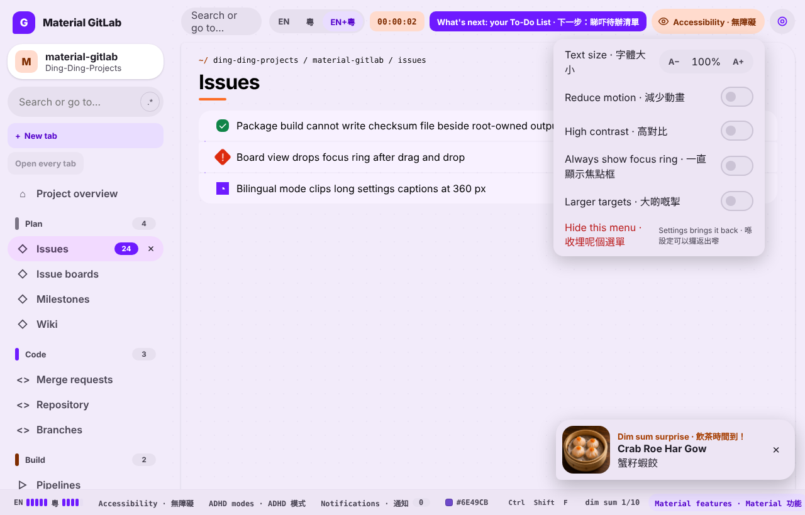
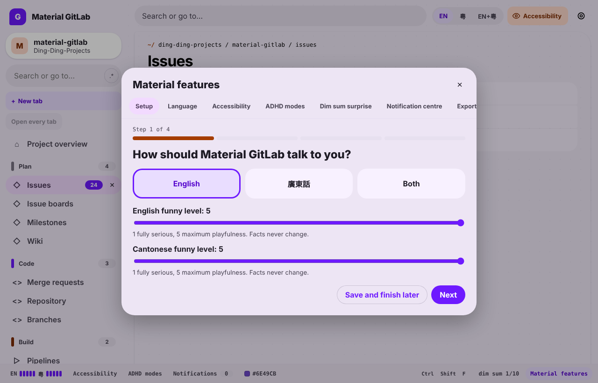

The feature layer brings the shared shell features from the design canvas into every page that
uses the Material shell. It mounts from `app/assets/javascripts/entrypoints/super_sidebar.js`
through `mountFeatureLayer` in `material_system/mounts.js`, and only when the Material sidebar
host is present.

Both captures come from the real components and stylesheets rendered in an isolated Vue 2.7
harness, not from a running GitLab instance.

## Top bar

`surfaces/FeatureLayer/TopbarFeatures.vue`, rendered into the shell's `actions` slot:

- **Language**: EN, 粵 or EN+粵. Persists to the Material settings and applies at once.
- **Accessibility** (always visible unless you hide it): text size, reduce motion, high
  contrast, always show focus ring, larger targets. Hiding the menu is reversible from the
  feature hub.
- **ADHD modes**: Focus, Low stimulation, Time awareness, One thing at a time and Momentum. Each
  is off by default and independent of the others.
  - Time awareness shows an elapsed-time chip for the current page.
  - One thing at a time shows a link to your To-Do List.
  - Momentum moves focus to the next to-do after you mark one done on the To-Do List.

## Features rail

A thin bar fixed to the bottom of the page shows the language and both funny levels, the
accessibility and ADHD entries, the notification count, the seed color, the command palette
shortcut and the dim sum chance. Each entry opens the matching tab of the feature hub.

## Feature hub and setup wizard

`surfaces/FeatureLayer/FeatureLayer.vue` holds a dialog with tabs for setup, language,
accessibility, ADHD modes, dim sum, the notification centre and settings export.

The setup wizard (`SetupWizard.vue`) opens on first run. It has four steps: language and funny
levels, appearance (optional), comfort (optional), then a summary. Each step applies its
setting immediately. Back, Next, Skip and **Save and finish later** are available, progress is
saved after every move, and the wizard resumes at the saved step. Finishing closes the hub and
returns focus to the page.

## Dim sum surprise

About 1 in 10 page loads, after setup is complete, shows one dish from the public catalog
(`Ding-Ding-Projects/dim-sum-photos`) with its English and Traditional Chinese names. It never
shows over an open dialog or on error pages, never takes focus, and cannot be turned off. Trying
to switch it off in the hub shows a notice instead.

Names and alt text for the first 150 catalog entries are bundled in
`features/dim-sum-catalog.js`. Photos are not copied into this repository. The card loads each
photo from the catalog's published release, so an instance without internet access shows a
labelled placeholder instead of the photo.

## Page-wide effects

`features/document.js` writes these attributes on `<html>`, and
`md3/components/_feature_layer.scss` reads them:

| Attribute | Set by |
|-----------|--------|
| `data-m3-motion` | Reduce motion, or the Low stimulation mode |
| `data-m3-density` | Density setting |
| `data-m3-language` | Language setting |
| `data-m3-focus` | Focus mode (dims the sidebar, top bar and rail until hovered) |
| `data-m3-low-stimulation` | Low stimulation mode (mutes non-status badges) |
| `data-m3-high-contrast` | High contrast |
| `data-m3-focus-ring` | Always show focus ring |
| `data-m3-large-targets` | Larger targets (44 px minimum) |

Text size sets the root font size.

`md3/components/_gitlab_signature.scss` applies the canvas signature details to GitLab's own
pages:

- the dot-grid backdrop and the notched content pane
- the mono `~/` breadcrumb and the orange bar under page titles
- shape-coded CI status icons, the branch rail on issue and merge request lists, and staggered
  row motion

All motion is removed under reduced motion.

## Storage

| Key | Contents |
|-----|----------|
| `material-system.settings.v1` | Language, funny levels, theme, density, seed color, text size, motion |
| `material-system.adhd-modes.v1` | The five ADHD modes |
| `material-system.accessibility-tools.v1` | Accessibility tools and whether the menu is hidden |
| `material-system.setup-wizard.v1` | Setup step, skipped steps, completion |

Export (in the hub) downloads settings, ADHD modes and accessibility tools as UTF-8 JSON.

## Tests

- `spec/frontend/material_system/feature_layer_spec.js`

## Known limitations

- The theme choice in setup changes the Material shell theme. GitLab's own dark stylesheet still
  follows the user preference on the server.
- The extensions manager, Support Tickets, unlock ladder, school mode, schedules, personal
  wording, logo and color translator from the design canvas have models in `material_system/`
  but no in-app screens yet.
