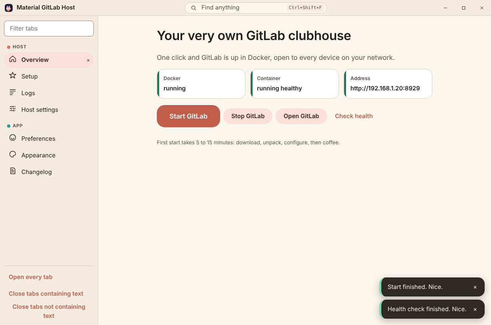

Material GitLab Host (`tools/material-gitlab-deployer`) is the one-click Windows host for the
Material GitLab container. It is a frameless Material 3 window around
`deploy/windows/host.ps1`. The package README covers the full behavior:
[`tools/material-gitlab-deployer/README.md`](../../../tools/material-gitlab-deployer/README.md).

## Behavior

- **Start** runs `host.ps1 up`, then a health check. **Stop**, **Check health** and **Fetch container
  log** run `stop`, `health` and `logs-tail`. No other command can be requested.
- Host files are copied to `%LOCALAPPDATA%\MaterialGitLabHost` on each launch, and `.env` there is
  never overwritten. `host.ps1` honors `MATERIAL_GITLAB_HOST_ROOT`, `MATERIAL_GITLAB_ASSUME_YES` and
  `MATERIAL_GITLAB_NO_BROWSER` for this.
- The Host settings tab edits `GITLAB_HOSTNAME`, `GITLAB_HTTP_PORT`, `GITLAB_SSH_PORT`,
  `GITLAB_MEMORY_LIMIT` and `GITLAB_CPU_LIMIT` with validation in both the window and the main
  process. Every other `.env` line, including any root password line, is kept as is and never shown.

## Failure modes

| Situation | What the window does |
| --- | --- |
| Not Windows | Shows a note; Start, Stop and the other actions return a platform error toast. |
| Docker missing and consent off | `host.ps1` skips the install and fails at the Docker step; Logs shows the exact step. |
| A run hangs | **Cancel** ends the PowerShell process tree. Docker keeps whatever it reached; nothing is deleted. |
| Offline | Update checks report "could not check" and the app keeps working; the dim sum photo shows a placeholder after eight seconds. |
| Update package hash mismatch | No banner appears; the package is discarded. |

## Security

- Renderer: `contextIsolation`, `sandbox`, no Node, strict CSP with `script-src 'self'`, no
  navigation, external links limited to `http` and `https`.
- PowerShell is spawned in one place with a fixed argument list ending in an allowlisted command.
- The app never reads, prints or exports a password or token. Exports are the log lines on screen
  (UTF-8 text) and preferences (JSON); `.env` is not included in either.
- Installers and update packages are unsigned. Update integrity is the SHA-1 and size from the
  release's `RELEASES` index, which is integrity against corruption, not publisher authenticity.

## Verification

- `npm test` in the package: 13 tests pass. Guards were watched failing by turning the renderer
  sandbox off and by adding an extra command to the allowlist.
- The built renderer was driven in Chrome with a test double for the preload bridge: wizard gating,
  start and health calls with consent, the Open address, plain and regex log search including an
  invalid pattern, `.env` validation errors, palette teleport to the accent control, closed tabs
  staying closed across a reload, Open every tab, bilingual layout at 760 px, dark theme, update
  banner and dim sum card. Screenshots in `img/host_app_*.png` come from that run.
- Not verified here: the packaged Electron app on Windows, PowerShell and Docker runs, Squirrel
  install events and an actual update. The Windows release workflow builds and publishes the
  installer; it does not run it.
