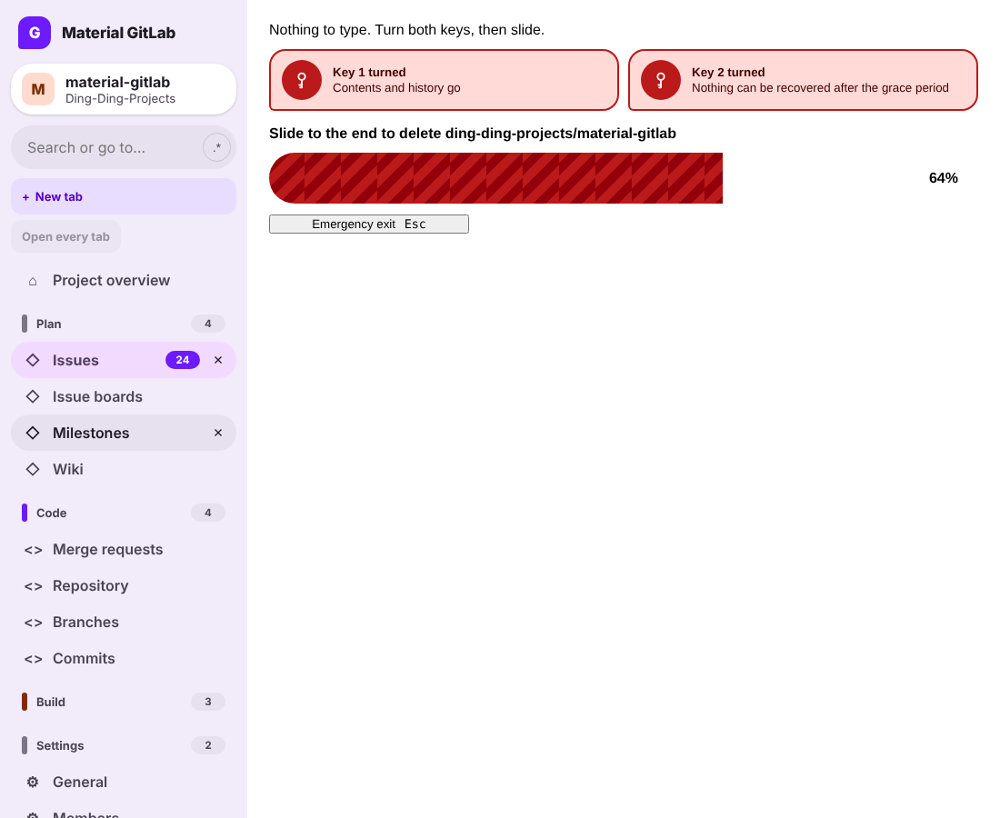

The Material sidebar (`app/assets/javascripts/material_system/surfaces/Sidebar/Sidebar.vue`) is a
vertical tab strip docked on the left. Every navigation destination is an open tab, and each
navigation section is a collapsible tab group.

The capture comes from the real components rendered in an isolated Vue 2.7 harness. The
emergency exit button there uses a plain stand-in for the GitLab UI button, so it looks unstyled.

## Behavior

- **Every tab open by default.** A fresh install opens every destination in page order. After an
  update, only destinations the strip has never offered before open. A tab you closed stays
  closed across restarts.
- **Close buttons** show on the active tab, and on any tab you hover or focus.
- **New tab** opens a catalog of every destination with a search field. Closed tabs are marked
  and reopen from there.
- **Open every tab** reopens every closed tab at once. It is disabled, with a reason in its
  tooltip, when nothing is closed.
- **Tab groups** collapse and expand. The group holding the active tab always stays expanded, and
  the active tab is never hidden, even if it was closed earlier.
- The search field above the strip filters open tabs, with the regex builder beside it.

State is stored in `localStorage` under `material-system.tab-strip.v1`
(`app/assets/javascripts/material_system/tab-strip-state.js`). A damaged record is treated as a
fresh install.

## Keyboard and accessibility

- The strip is `role="tablist"` with `aria-orientation="vertical"`. Each destination is a
  `role="tab"` link with `aria-selected`.
- <kbd>Arrow up</kbd> and <kbd>Arrow down</kbd> move between tabs. <kbd>Delete</kbd> closes the
  focused tab.
- Each close button is labelled with the tab name.

## Tests

- `spec/frontend/material_system/sidebar_tab_strip_spec.js`

## Known limitations

- Pinning, dragging to reorder, the four separate tab searches and the dock-edge picker exist in
  the tab workspace model (`material_system/tabs.js`) and the design canvas, but are not yet
  wired into this sidebar.
