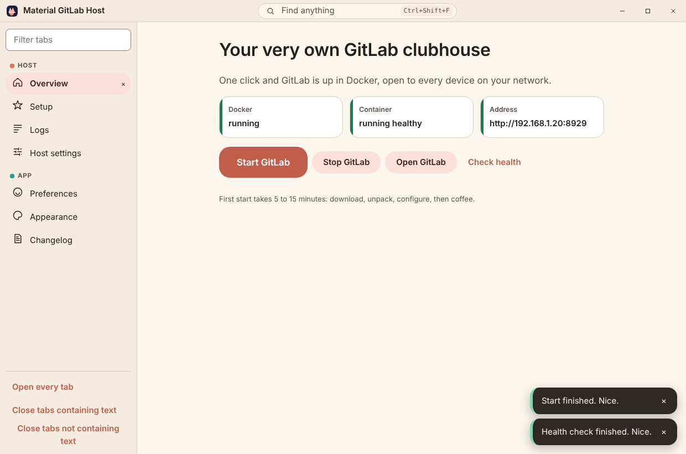
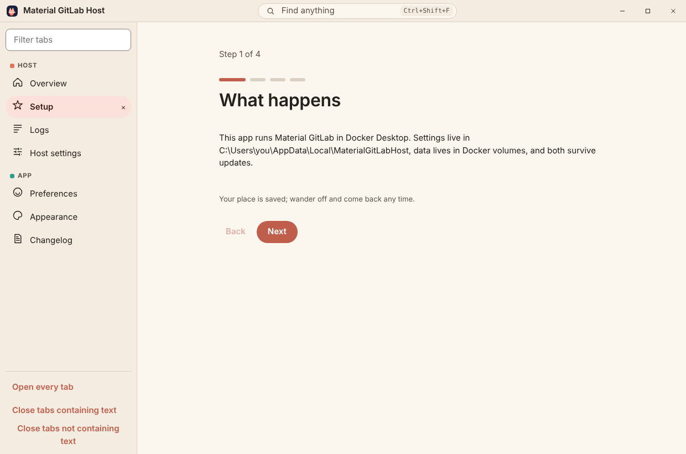
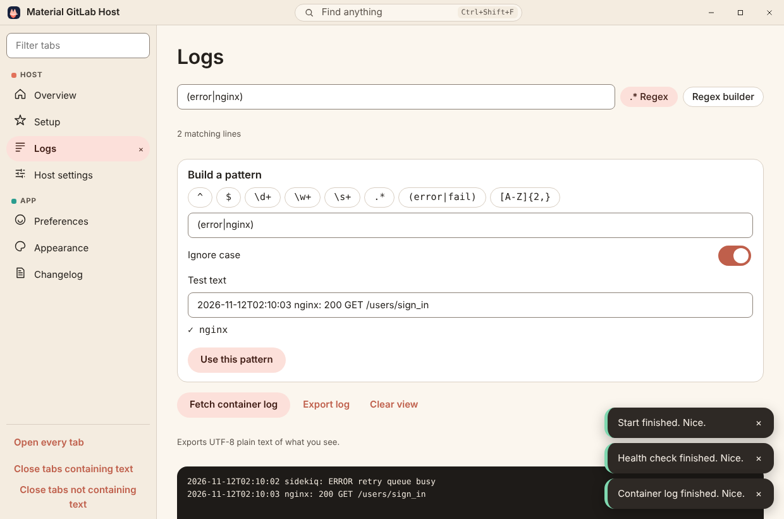
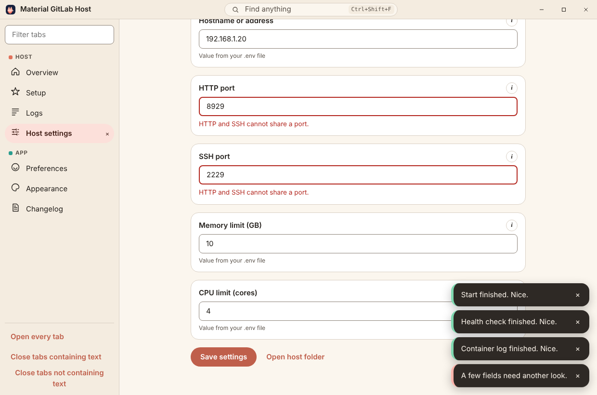
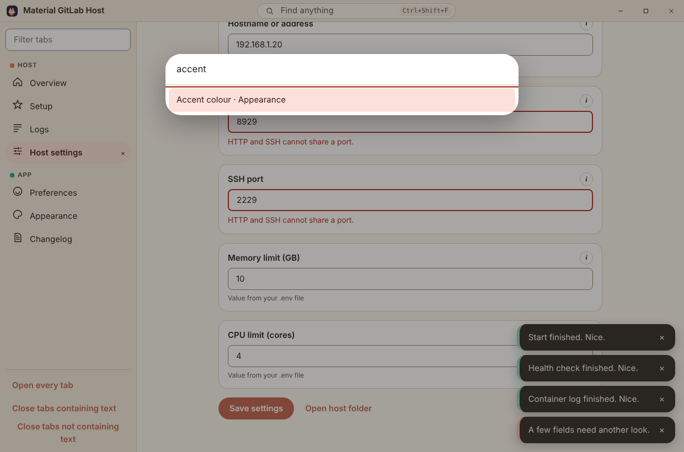
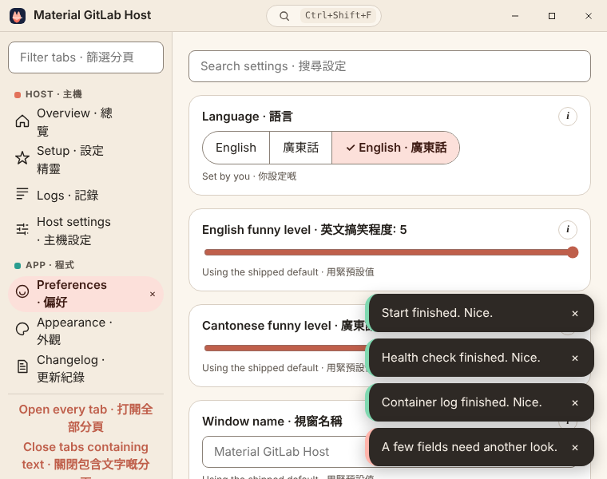
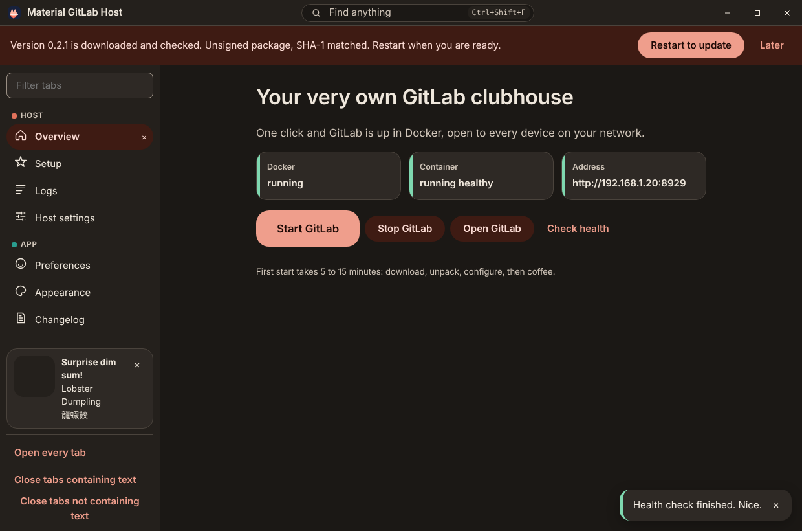

# Material GitLab Host

A Windows desktop app that hosts Material GitLab on this PC with one click. It runs the same
[`deploy/windows/host.ps1`](../../deploy/windows/host.ps1) as `host.bat`, but from a window: Start,
Stop, Open, health, live logs and the `.env` settings, with no console to babysit.

The package directory keeps its old name (`tools/material-gitlab-deployer`) and the Squirrel id
`material-gitlab-deployer`, so existing installs of the earlier preview shell update in place.



## What it does

| Action | What runs | Notes |
| --- | --- | --- |
| Start GitLab | `host.ps1 up` | Installs Docker Desktop with winget if missing (Windows shows its own administrator prompt), writes `.env` with this PC's LAN address on first run, pulls or builds the image, starts the container on named volumes, waits for GitLab's health check, optionally opens the two ports in Windows Firewall. |
| Stop GitLab | `host.ps1 stop` | Stops the container. Never removes it or its volumes. |
| Check health | `host.ps1 health` | Reports Docker, the container state and the address; the Open button uses that address. |
| Fetch container log | `host.ps1 logs-tail` | The last 400 lines of the GitLab container log. |

Those four commands (plus `status`) are the only things the window can ask for. The main process
maps each to a fixed `host.ps1` argument; nothing the renderer sends is passed to PowerShell.

The bundled `docker-compose.yml`, `deploy\windows` and `deploy\docker` (without any `.deb`) are
copied to `%LOCALAPPDATA%\MaterialGitLabHost` at every launch, so an app update brings the newest
scripts. `.env` in that folder is the user's and is never copied over or removed.

Consent: the setup wizard (and the Overview card until setup is finished) asks whether Start may
install Docker Desktop and open the firewall ports. When either is allowed, the app sets
`MATERIAL_GITLAB_ASSUME_YES=1` for that run, so `host.ps1` answers its own questions with yes and
logs `(approved in the Host app)`. Without consent it runs silently and skips those steps.

## Screens

| Screen | |
| --- | --- |
| Setup wizard, resumable, with Back, Next and Skip |  |
| Logs with plain search, an explicit regex toggle and the regex builder |  |
| Host settings: validated `.env` editor with inline errors |  |
| Command palette (`Ctrl+Shift+F`) that jumps to the exact control |  |
| Bilingual mode at the minimum window width |  |
| Dark theme, the unsigned update banner and the dim sum surprise |  |

These are the built renderer (`dist/renderer`) in Chrome with a test double in place of the
Electron preload bridge, captured on Linux. They show the real UI code; they are not a capture of
the packaged app running Docker on Windows.

## Everything else in the window

- Frameless window with its own title bar; left-docked tab strip with every tab open on first
  launch, close buttons, pinning (`Ctrl+P` or right click), `Alt+Up/Down` to reorder, a filter, Open
  every tab, and close tabs containing (or not containing) text with a preview first.
- English, Hong Kong Cantonese, or both; two funny-level sliders (1 to 5, default 5) that change
  wording only.
- Accessibility switches (high contrast, larger targets, reduce motion, always-on focus ring) and
  four separate focus helpers (focus view, lower stimulation, elapsed time, what is next).
- Appearance: theme, density, any accent colour (HEX, RGB, HSL shown), text size, undo, reset and
  preset export. The window name can be changed without touching the installed identity.
- Preferences export and import as JSON, an in-app changelog with date filter and search, corner
  toasts for everything that is not a decision.
- Dim sum surprise: about one launch in ten, a dish from the public dim-sum catalog appears in the
  tab strip. Only names are bundled; the photo comes from the catalog release and shows a labelled
  placeholder when offline.

## Updates

About fifteen seconds after launch and every six hours, the app finds the newest GitHub release in
this repository that carries `material-gitlab-deployer-RELEASES`, reads the full package's SHA-1
and size from it, downloads that `.nupkg`, checks both, and hands it to Squirrel's `Update.exe`.
Only then does a banner offer **Restart to update**; it says plainly that the package is unsigned.
Nothing restarts on its own.

## Build

```bat
build.bat            rem build and offer to launch
build.bat /s         rem silent
build-installer.bat /s
```

`build.bat` needs nothing preinstalled: when Node.js 20+ is not on `PATH` it downloads portable
Node.js 22.12.0 from nodejs.org into `.tools\node`, checks it against the published SHA-256 list,
then runs `npm ci` and `npm run build`. `build-installer.bat` builds, packages with the checked-in
electron-builder Squirrel.Windows configuration (`--publish never`), checks `Setup.exe`, `RELEASES`
and the full `.nupkg` exist, confirms `Setup.exe` is unsigned, and prints SHA-256 values. It never
publishes. [`windows-release.yml`](../../.github/workflows/windows-release.yml) runs the same script
on every push and publishes the assets as `material-gitlab-deployer-Setup.exe`,
`material-gitlab-deployer-RELEASES` and `material-gitlab-deployer-<version>-full.nupkg`.

Code signing is permanently disabled. Windows may show an unknown-publisher warning.

## Tests

`npm test` builds, then runs `node --test test/*.test.mjs`: the command allowlist (and that each
command exists in `host.ps1`), health parsing, URL restrictions, `.env` round trips that keep
unrelated lines, settings validation, the Squirrel `RELEASES` parser, and source guards for the
sandboxed window, the single PowerShell spawn, the preload surface, the CSP and the packaging.
